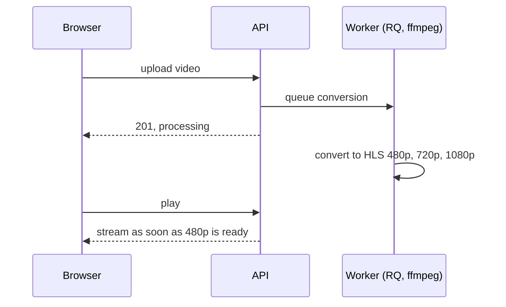

# Videoflix Backend

This is the backend REST API for **Videoflix**, a video streaming platform inspired by Netflix, built with Django, Django REST Framework, and Docker.

[](https://github.com/PhilippKlinger/videoflix-backend/actions/workflows/ci.yml)
[](https://github.com/PhilippKlinger/videoflix-backend/actions/workflows/security.yml)
[](https://github.com/PhilippKlinger/videoflix-backend/actions/workflows/codeql.yml)
[](https://scorecard.dev/viewer/?uri=github.com/PhilippKlinger/videoflix-backend)


[](LICENSE)
[](https://videoflix.philipp-klinger.com)

## Table of Contents

- [Overview](#overview)
- [How it works](#how-it-works)
- [Tech stack](#tech-stack)
- [Getting started](#getting-started)
- [CI and security](#ci-and-security)
- [Related repositories](#related-repositories)
- [License](#license)

## Overview

- Sign-up with email activation, JWT login in cookies, password reset and permanent account deletion
- Video upload with quota and ffprobe checks, conversion to HLS in 480p, 720p and 1080p by a background worker
- Streaming per resolution, playable as soon as 480p is ready
- Django admin with import and export
- API documentation generated from the code (Swagger, Redoc)

## How it works

From upload to playback: the API checks and stores the file, a worker converts it to HLS in the background, and the player streams it as soon as the first resolution is ready.



## Tech stack

- Python 3.13, Django 5.2, Django REST Framework
- PostgreSQL, Redis with django-rq for background jobs
- ffmpeg for thumbnails and HLS
- Gunicorn, Docker
- drf-yasg for Swagger and Redoc

## Getting started

```bash
cp .env.dev.template .env                       # local settings
docker compose --profile dev up -d --build       # web, worker, Postgres, Redis
docker compose --profile dev exec web python manage.py createsuperuser
docker compose --profile dev exec web python manage.py test
```

The API documentation is then at `http://127.0.0.1:8000/swagger/` and `/redoc/`.

## CI and security

- **Lint and tests:** ruff, Django tests against Postgres and Redis, migration check, coverage gate of 89 %
- **Security checks:** secret scan (gitleaks), dependency review, `pip-audit`, workflow lint (zizmor)
- **CodeQL** for Python and the workflows
- **Image:** Trivy scan on every pull request; on `main` the image is published to GHCR with SBOM and build provenance

Lint, tests, security checks and CodeQL are required before a merge. A merge to `main` starts the deploy in [videoflix-deploy](https://github.com/PhilippKlinger/videoflix-deploy).

## Related repositories

| Repository | Role |
|---|---|
| [videoflix-frontend](https://github.com/PhilippKlinger/videoflix-frontend) | Angular app that uses this API |
| [videoflix-deploy](https://github.com/PhilippKlinger/videoflix-deploy) | Production stack: images by digest, deploy with smoke test and rollback, backup and restore test |
| [vps-edge](https://github.com/PhilippKlinger/vps-edge) | Reverse proxy with TLS in front of the stack |

## License

[MIT](LICENSE)
